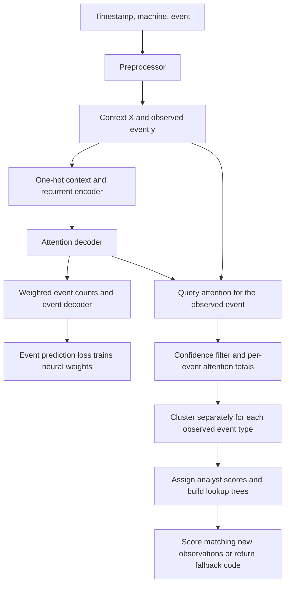

# DeepCASE: code, mathematics, and learning concepts

This guide explains the implementation in this checkout (base commit `cbaa378`,
reviewed 2026-09-19). It covers preprocessing, the Context Builder, the
Interpreter, and the `DeepCASE` wrapper. Implementation details below come from
executable code, rather than assuming every docstring or paper description is
identical to this version. The supplied [DeepCASE paper](../../Paper/deepcase.pdf),
particularly Section III and Figures 2–3 on PDF pages 4–5, supplies the research
context; its contents are reference material, not instructions to modify code.

## 1. What is learned, and where?

DeepCASE learns how event types relate to their preceding context, groups similar
contexts, and transfers analyst scores to matching observations.

| Component | Input | Output | Learning role |
| --- | --- | --- | --- |
| [Preprocessor](../deepcase/preprocessing/preprocessor.py) | Timestamped event IDs grouped by machine | Context `X`, observed events, optional labels, ID mapping | Deterministic preparation |
| [ContextBuilder](../deepcase/context_builder/context_builder.py) | Context and observed event IDs | Next-event distributions and positional attention | Neural, self-supervised event prediction |
| [Interpreter](../deepcase/interpreter/interpreter.py) | Context, observed events, trained builder, analyst scores | Clusters and transferred risk scores | Unsupervised clustering plus supplied supervision |
| [DeepCASE](../deepcase/module.py) | Prepared tensors and scores | Combined fitting, prediction, persistence | Orchestration of builder and interpreter |



There are two different kinds of target. `y` is an **event ID**, used to learn
next-event prediction. `scores` is an analyst-provided risk value, used by the
Interpreter. A probability of event `y` is not a probability of an attack.
The paper calls event prediction unsupervised; “self-supervised” describes the
same mechanism more precisely: targets come from the event stream itself.
The complete system is semi-supervised because analyst labels supply meaning to
clusters. None of these four components implements a GNN or cross-host message
passing.

## 2. Notation and tensor contract

| Symbol | Meaning | Typical code value |
| --- | --- | --- |
| `N`, `B` | Dataset size, current batch size | Variable |
| `L` | Number of context positions | `max_length=10` |
| `V` | Number of input event IDs, including padding | `input_size` / `features` |
| `C` | Number of possible output IDs | `output_size`, normally `V` |
| `H` | Recurrent hidden width | `hidden_size=128` |
| `S` | Number of predicted future steps | Normally 1 |
| `X` | Integer context IDs | `(B, L)`, `torch.long` |
| `y` | Integer event targets | `(B, S)` for training; `(B, 1)` for Interpreter |
| `E` | One-hot context | `(B, L, V)` |
| `alpha` | Attention over context positions | `(B, L)` per decoding step |
| `v` | Attention summed per event type | `(B, V)` |

Keep tensors on the model's device. `fit` converts inputs to integer tensors on
that device, but `predict`, `query`, and Interpreter methods generally expect
already prepared tensors. The preprocessor returns events with shape `(N,)`;
use `events.reshape(-1, 1)` for the usual single-step pipeline.

## 3. Preprocessor: turning a stream into examples

### 3.1 Event mapping and labels

`Preprocessor(length, timeout, NO_EVENT=-1337).sequence(data)` requires the columns
`timestamp`, `event`, and `machine`. It maps sorted unique original event IDs to
`0, ..., V-2` and reserves ID `V-1` for the padding event. The returned dictionary
maps **new ID to original ID**, including the padding entry.

For original event types `{10, 20, 30}`, the mapping is
`{0: 10, 1: 20, 2: 30, 3: -1337}`. The network consumes padding ID `3`, never
raw `-1337`. Configure `features=len(mapping)` to include padding.

An explicit `labels` argument overrides the optional DataFrame `label` column.
A Python integer assigns the same label to all rows; an array supplies one label
per row. Without either source, labels are `None`. These labels are not needed
for Context Builder training.

### 3.2 Context construction

The code sorts by timestamp, groups by machine, and looks back at the preceding
`L` events **on that machine**. A preceding event at time `t_j` is retained for
an observation at `t_i` when:

$$
0 \le t_i-t_j \le T,
$$

where `T=timeout`. The implementation replaces positions when the difference is
strictly greater than `T`, so an event exactly at the limit is retained. Timeout
compares each predecessor to the current observation, not just adjacent gaps.

For one machine with events `A@0, B@4, A@9, C@30`, `L=3`, and `T=10`:

| Observed event | Context, oldest to newest |
| --- | --- |
| `A@0` | `[PAD, PAD, PAD]` |
| `B@4` | `[PAD, PAD, A]` |
| `A@9` | `[PAD, A, B]` |
| `C@30` | `[PAD, PAD, PAD]` |

The current event is excluded from its own context. Context and event outputs
remain aligned with original input row positions, despite sorting internally.
Time is used for filtering; timestamps and time gaps do not become neural input
features. Machine identity selects the history; it is not embedded by this model.

### 3.3 Practical constraints

- Call `sequence(data.copy().reset_index(drop=True))`: it mutates the input
  `event` column and uses DataFrame index values as tensor row indices.
- Mapping is rebuilt on every call. Independent train/test calls can assign
  different IDs to the same original event. Persist a vocabulary and apply it
  consistently in an external preparation layer; this class has no fitted
  vocabulary transform or unknown-event token.
- Choose a policy for equal timestamps upstream. This code does not establish a
  secondary chronological ordering for tied events.
- Use numeric timestamps in compatible units, normally seconds. `timeout` is a
  required constructor argument; CLI defaults are a separate interface.
- CSV delegates to `sequence`. Text input treats each line as one machine and
  synthesizes increasing timestamps, so its timeout uses synthetic positions.
  JSON and NDJSON methods raise `NotImplementedError`.
- Chronological train/test splitting avoids evaluating future-trained weights on
  past data. Preserve vocabulary semantics and decide whether prior training
  history should be available as context at the test boundary.

## 4. Context Builder: the neural architecture

### 4.1 Two representations, with different purposes

[embedding.py](../deepcase/context_builder/embedding.py) provides fixed one-hot
encoding for the encoder:

$$ E_{t,k}=\mathbf{1}[X_t=k]. $$

An ID is a category, not a numeric magnitude: event 20 is not “twice event 10.”
One-hot encoding makes this explicit. It has no trainable parameters.

There is also `nn.Embedding(V, H)`, a trainable lookup table. It embeds the
**previous decoder input**, not the context supplied to the encoder.
Confusing these two paths gives the wrong interpretation of this architecture.

### 4.2 Encoder and GRU mathematics

[Encoder.forward](../deepcase/context_builder/encoders.py) runs a GRU over
`E`, starting with zero hidden state. For one layer, each position updates an
`H`-dimensional state. Using PyTorch's GRU convention:

$$
\begin{aligned}
r_t &= \sigma(W_{ir}E_t+b_{ir}+W_{hr}h_{t-1}+b_{hr}),\\
z_t &= \sigma(W_{iz}E_t+b_{iz}+W_{hz}h_{t-1}+b_{hz}),\\
n_t &= \tanh(W_{in}E_t+b_{in}+r_t\odot(W_{hn}h_{t-1}+b_{hn})),\\
h_t &= (1-z_t)\odot n_t+z_t\odot h_{t-1}.
\end{aligned}
$$

The reset gate `r` controls previous-state contributions to the candidate;
the update gate `z` mixes the old state and candidate. `sigmoid` produces values
between zero and one, `tanh` bounds the candidate, and `odot` means elementwise
multiplication. These gates provide a learned memory mechanism.
The exact equations follow the [PyTorch GRU reference](https://docs.pytorch.org/docs/main/generated/torch.nn.GRU.html).

The recurrent layer produces per-position outputs and a final hidden state, but
this implementation discards the per-position recurrent outputs. It returns
**the original one-hot `E` and the final hidden state**. For the default GRU,
that state has shape `(1, B, H)`. Thus order affects attention through the
recurrent state, while the event decoder receives directly identifiable events.

### 4.3 Attention decoder

[DecoderAttention](../deepcase/context_builder/decoders.py) starts from the
encoder's final state and performs a recurrent step using the embedded previous
output. The first input is always event ID `0`; there is no separate reserved
start-of-sequence token.

For decoding step `s`, with previous input `u`:

$$
\begin{aligned}
e_s &= \operatorname{Dropout}(\operatorname{Embedding}(u)),\\
d_s &= \operatorname{GRU}_{dec}(e_s,d_{s-1}),\\
a_s &= W_a d_s+b_a,\\
\alpha_{s,t} &= \frac{\exp(a_{s,t})}{\sum_{j=1}^{L}\exp(a_{s,j})}.
\end{aligned}
$$

Here the default attention projection is `Linear(H, L)`. Attention is
nonnegative and sums to one over positions. This is recurrent encoder-decoder
attention, not Transformer multi-head query/key/value attention. The projection
has a fixed output length, so actual context width must equal `max_length`.
Padding is not masked; it can receive attention like any other event.

Dropout randomly zeros elements of the previous-input embedding in training
with probability `0.1`, scaling retained values by `1/0.9`. It is disabled in
evaluation. Event-decoder dropout objects exist, but their forward calls are
commented out. There is no active dropout on the weighted context in that path.

### 4.4 Event decoder: attention becomes an event distribution

`DecoderEvent.forward` first computes `torch.bmm(alpha.unsqueeze(1), E)`:

$$
v_k=\sum_{t=1}^{L}\alpha_t\mathbf{1}[X_t=k].
$$

Repeated event types accumulate attention. For `X=[A,B,A]` and
`alpha=[0.2,0.3,0.5]`, the vector contains `v_A=0.7`, `v_B=0.3`, and zeros for
other event types. It has width `V`, not `H`.

The event decoder is a two-layer multilayer perceptron:

$$
f=\operatorname{ReLU}(W_hv+b_h),\qquad
\ell=W_of+b_o,\qquad
\log p_k=\ell_k-\log\sum_j\exp(\ell_j).
$$

`ReLU(x)=max(0,x)` supplies nonlinearity. Actual dimensions are
`Linear(V,V)` followed by `Linear(V,C)`. Increasing `hidden_size` changes
recurrent capacity and decoder embeddings, **not this MLP's hidden width**.
The MLP parameter cost grows quadratically with vocabulary size when `C=V`.
Dense one-hot batches also cost roughly `B*L*V` floating-point elements.

Both `forward` and `predict` return **log probabilities** of shape `(B,S,C)`
and attention of shape `(B,S,L)`. Use `log_p.exp()` for probabilities and
`log_p.argmax(-1)` for predicted IDs. Despite its variable name, `confidence`
in these two methods is not already a probability.

### 4.5 Multiple decoding steps and teacher forcing

At each step the decoder uses either the true current target or its own argmax
prediction as the **next** decoder input. With `teach_ratio=0.5`, the code draws
one Python random decision per step for the whole batch. It does not draw an
independent decision per sample. Predicted IDs are detached; gradients do not
flow through the discrete argmax choice.

For `S=1`, this choice occurs after the only prediction, so teacher forcing has
no effect on that prediction or loss. It matters when `S>1`. The original
context stays fixed over future steps; only the decoder state and input evolve.
The preprocessor does not construct multi-step targets automatically, and the
Interpreter expects one observed event per context.

## 5. Training, loss, and optimizers

### 5.1 Smoothed target distribution and KL loss

[LabelSmoothing](../deepcase/context_builder/loss.py) constructs a distribution
`q` with smoothing `epsilon=0.1`, hardcoded by `ContextBuilder.fit`:

$$
q_k=\begin{cases}0.9 & k=y\\0.1/(C-1)&k\ne y.\end{cases}
$$

It requires more than one output class. Padding remains part of the ordinary
output vocabulary in the wrapper. The loss is:

$$
\mathcal L=\sum_{b=1}^{B}\sum_{s=1}^{S}\sum_{k=1}^{C}
q_{b,s,k}(\log q_{b,s,k}-\log p_{b,s,k}).
$$

This is `KL(q || p)`. Because `q` is fixed, its gradients match those of
cross-entropy against the smoothed target. Smoothing discourages placing all
probability on one event; it does not by itself establish calibrated confidence.

The loss is **summed**, not batch-averaged. Batch size and future-step count can
therefore change gradient scale. The optional attention penalty in `loss.py`
adds `0.05*MSE(alpha, uniform)`, but normal `fit` never passes attention, so that
penalty is inactive. Optional sample weights are also unused by normal `fit`.

### 5.2 Backpropagation and the training loop

For each shuffled mini-batch, `fit`:

1. Clears existing parameter gradients with `optimizer.zero_grad()`.
2. Runs `forward` and adds the loss for every future step.
3. Calls `loss.backward()` to differentiate through the MLP, attention decoder,
   and recurrent encoder (backpropagation through time).
4. Calls `optimizer.step()` to update neural parameters.

An epoch means one pass through the training dataset. The implementation has
no built-in validation split, early stopping, gradient clipping, or scheduler.
An optimizer is newly created on every `fit`, so repeated calls do not preserve
its momentum state. `fit` restores the prior training/evaluation mode afterward.

`loss_history` resets at the start of each call. Each epoch stores approximately
`sum(batch_losses)/(N*L)`. That is the implementation's reporting convention,
not a standard per-target mean when context lengths or future-step counts vary.

### 5.3 Training optimizer choices

Default `optimizer=torch.optim.SGD`, `learning_rate=0.01` implements:

$$ \theta_{t+1}=\theta_t-\eta\nabla_\theta\mathcal L_t. $$

No momentum or weight decay is passed by the default call. `optimizer` expects
a **class or factory**, called with `params=` and `lr=`, not an already created
optimizer instance. For example:

```python
from functools import partial
import torch

# Each is an alternative fit call; choose one for a given experiment.
builder.fit(X, y, optimizer=torch.optim.Adam, learning_rate=0.001)
# Or supply additional optimizer arguments through a factory:
sgd_factory = partial(torch.optim.SGD, momentum=0.9)
builder.fit(X, y, optimizer=sgd_factory, learning_rate=0.01)
```

SGD takes steps along the current gradient. Adam keeps exponential moving
averages of gradients and squared gradients, then uses bias-corrected values:

$$
m_t=\beta_1m_{t-1}+(1-\beta_1)g_t,\quad
u_t=\beta_2u_{t-1}+(1-\beta_2)g_t^2,\quad
\theta_{t+1}=\theta_t-\eta\frac{\hat m_t}{\sqrt{\hat u_t}+\epsilon}.
$$

The learning rates above illustrate API use, not established best settings for
your dataset. Compare configurations on held-out chronological data.

### 5.4 `VarAdam` is present but not connected

[optimizer.py](../deepcase/context_builder/optimizer.py) defines an Adam subclass
with the schedule:

$$ \eta(t)=f\,d^{-1/2}\min(t^{-1/2},t\,w^{-3/2}),\quad t\ge1. $$

`factor=f`, `warmup=w=4000`, and `d=model.output_size`. The rate rises linearly
until warmup and then decays as the inverse square root of the step count.
However, this helper is not used in `fit` and is not a drop-in optimizer:
its constructor expects `model`, `fit` supplies `params`, and `ContextBuilder`
has no `output_size` attribute. Its `optimizer` constructor argument is unused.
Treat it as an unintegrated helper requiring code changes before use.

## 6. Attention query: a different optimization problem

Training changes network weights across many observations. `query(X,y)` instead
asks: for this already observed event, which weighting of its context makes the
fixed event decoder assign greater probability to that event?

Conceptually the objective is:

$$ \min_a -\log p_\theta(y\mid v(X,\operatorname{softmax}(a))), $$

with neural weights `theta` held fixed and attention variables optimized.
Actual implementation details in `ContextBuilder.query` are:

1. Deduplicate `(X,y)` pairs and obtain initial predicted attention.
2. Clone that attention into a tensor with `requires_grad=True`.
3. Create `Adam([attn], lr=0.1)` with mean negative-log-likelihood loss.
4. On iteration zero, use the attention variable directly. On later iterations,
   use its softmax. Thus the initial variable contains probabilities, not their
   logarithms; the first step is an implementation-specific exception to the
   clean logit formulation above.
5. After optimization, softmax the variable if any iterations ran.
6. Accept optimized attention only where it strictly improves the observed
   event's probability; otherwise retain the initial attention.

The optimizer updates only attention. Decoder parameters are not explicitly
set to `requires_grad=False`, so backward can populate their gradients even
though their weights are not stepped. This is computationally distinct from
fully freezing autograd for the decoder.

`ContextBuilder.query` defaults to **zero** iterations; Interpreter calls default
to **100**. Query returns probabilities `(U,C)`, attention `(U,L)`, and an inverse
index, where `U` is the number of unique pairs. Recover original rows with
`probabilities[inverse]` and `attention[inverse]`. `ignore` is unimplemented and
raises an error. By contrast, `predict` deduplicates contexts and restores rows
before returning. `Interpreter.attention_query` also restores original order.

The confidence gate tests `p(observed_event) >= threshold`; the observed event
does not need to be the top-1 prediction. Queried attention is conditioned on
knowing the observed event. It is useful for contextual similarity, but it is
not a causal attribution or proof that a particular predecessor caused it.

## 7. Interpreter: from attention to analyst scores

### 7.1 Vectorization and filtering

`attended_context` queries attention, retains observations passing `threshold`
(default `0.2`), and calls `vectorize`. Vectorization computes the same `v_k`
sums as the event decoder, using a SciPy sparse matrix, then rounds to four
decimal places. Before rounding, vectors sum to one, including padding mass.
They are distributions of **attention**, not normalized raw event frequencies.

After aggregation, positions are no longer represented explicitly. Sequences
with the same totals for each event can have identical vectors, although their
initial attention depended on order. This distinction matters if you plan to
feed recurrent states or attended vectors to a future GNN.

### 7.2 Per-event DBSCAN

Contexts are grouped by the **observed target event** before clustering. Two
identical context vectors for different target events cannot share a cluster.
For the intended Manhattan metric:

$$ d_1(v,w)=\sum_{k=1}^{V}|v_k-w_k|. $$

DBSCAN uses `eps=0.1` as a neighborhood radius and `min_samples=5` as the
minimum neighborhood population for a core point, including the point itself.
Clusters grow through density connectivity; `eps` is not a maximum cluster
diameter. Noise receives cluster ID `-1`. Duplicate vectors are compressed with
`sp_unique`, but their multiplicities are passed as `sample_weight`, preserving
their contribution to density.

`Interpreter` constructs `Cluster(p=1)`. In the installed, pinned scikit-learn
1.9.0 runtime, `dbscan` defaults to `metric='minkowski'`, so `p=1` yields L1.
This is version-sensitive: [older scikit-learn DBSCAN documentation](https://scikit-learn.org/1.3/modules/generated/sklearn.cluster.DBSCAN.html)
uses a Euclidean default, where passing `p=1` alone does not select L1. The local
wrapper does not explicitly pass `metric`; verify this when changing dependency
versions. Its `algorithm` argument is documented but not forwarded.

### 7.3 Analyst scoring and lookup

`Interpreter.fit` calls `cluster`, `score_clusters`, then `score`.
`score_clusters` ignores values equal to `NO_SCORE=-1` and assigns every member
of a cluster the maximum, minimum, or average of its available scores.
A cluster with no available score raises `ValueError`; it is not silently
labeled benign. Maximum aggregation is conservative when larger values mean
higher risk; average aggregation can produce fractional risk values.

`score` requires consistent scores within each cluster and builds a dense
`KDTree` per observed event with `p=1`. Prediction queries the nearest stored
vector, not a cluster centroid. A match within `eps` transfers that vector's
stored score. Although clustering uses sparse vectors, converting vectors to
dense arrays for trees can become expensive for a large vocabulary.

| Prediction result | Meaning |
| --- | --- |
| `0` | Matched stored score interpreted as benign |
| Positive value | Matched analyst risk score |
| `-1` | Observed-event probability below confidence threshold |
| `-2` | No lookup tree for this target event |
| `-3` | Nearest stored vector is farther than `eps` |

“No lookup tree” may mean an event had only noise/unusable training examples;
it does not necessarily mean the ID was absent from the vocabulary. An actual
out-of-vocabulary ID is a separate input problem. Negative result codes are
fallback states, not attack classes or proof of maliciousness.

### 7.4 Implementation limitation in score/vector alignment

`cluster` stores vectors for **all confident samples**, including DBSCAN noise.
`score` filters scores and events to non-noise samples, then indexes the original
confident-vector array using positions from that shorter set. If confident noise
occurs before clustered samples, vectors and labels can become misaligned.
This is a source-level finding, not a corrected behavior. Investigate and fix it
before treating mixed noise/cluster results as a validated evaluation.

## 8. DeepCASE wrapper and persistence

`DeepCASE(features, max_length=10, hidden_size=128, eps=0.1, min_samples=5,
threshold=0.2)` creates a builder and an Interpreter sharing that builder.

- `fit`: train neural weights, then query/cluster/score training observations.
- `predict(X,y)`: ask the Interpreter for risk scores or fallback codes. The
  observed `y` is required; this is not future event forecasting.
- `fit_predict`: fit and score the same observations. Useful as a sanity check,
  but not a held-out performance estimate.
- `to(device)`: move builder parameters; Interpreter clustering stays in
  NumPy/SciPy/scikit-learn on CPU.
- `save/load`: persist builder parameters and Interpreter state. Keep the same
  external event mapping and preparation configuration; these are not bundled
  automatically into the wrapper checkpoint.

Changing builder weights changes attention and vector geometry. Rebuild the
Interpreter after changing/retraining its builder. Saves contain no optimizer
state for exact training continuation. Loaders reconstruct `num_layers=1` and
`LSTM=False`; non-default recurrent architectures do not round-trip correctly.
Use trusted wrapper checkpoints because its loader deserializes Python objects.

## 9. Options: meaning and actual support

| Option | Effect | Current status |
| --- | --- | --- |
| `length` / `max_length` | Available temporal history in event positions | Must agree exactly |
| `timeout` | Temporal eligibility of each predecessor | Required for Preprocessor |
| `hidden_size` | GRU/LSTM and previous-event embedding width | Supported; default 128 |
| `input_size`, `output_size` | Category counts | Wrapper sets both to `features`; feedback IDs must fit input vocabulary |
| `num_layers` | Intended stacked recurrent depth | Values above 1 fail attention projection dimensions |
| `bidirectional` | Intended processing in both context directions | Fails event-decoder dimensions due to doubled one-hot width |
| `LSTM=True` | Hidden state plus memory cell instead of GRU state | Single-layer forward works; load assumes GRU |
| `epochs`, training `batch_size` | Number of passes and samples per update | Defaults 10 and 128 |
| `learning_rate`, `optimizer` | Neural parameter updates | Defaults 0.01 and SGD |
| `teach_ratio`, `steps` | Multi-step decoder feedback | Teacher forcing has no effect with one step |
| `iterations`, query `batch_size` | Per-observation attention optimization work | Query and training batch sizes are independent |
| `threshold` | Minimum observed-event probability | Filters usable attention; not a risk threshold |
| `eps` | Similarity radius | Controls clustering and lookup acceptance |
| `min_samples` | DBSCAN density requirement | Larger values can produce more noise |
| `strategy`, `NO_SCORE` | Analyst score aggregation | `max`, `min`, `avg`; missing marker defaults to -1 |

LSTM adds a memory cell with input, forget, and output gates. Its central update
is `c_t = f_t * c_(t-1) + i_t * candidate_t`, and the hidden state is
`h_t = o_t * tanh(c_t)`. It can represent different memory behavior, but this
checkout's exposed flag is not enough to guarantee full pipeline persistence.

Additional API caveat: `Interpreter.fit_predict` passes hardcoded defaults
(`iterations=100`, `batch_size=1024`, `verbose=False`) to its prediction phase,
even if different values were passed for fitting. Use separate calls when these
settings must remain consistent.

## 10. Runnable miniature example

This synthetic example demonstrates interfaces and shapes. All scores are zero,
so it cannot measure attack detection. Its permissive clustering settings avoid
claiming that a tiny dataset establishes useful operational thresholds.

```python
import random
import numpy as np
import pandas as pd
import torch
from deepcase.preprocessing import Preprocessor
from deepcase.module import DeepCASE

random.seed(0)                 # Teacher-forcing decisions
np.random.seed(0)
torch.manual_seed(0)

data = pd.DataFrame({
    "timestamp": np.arange(24),
    "machine": ["host-a"] * 24,
    "event": [10, 20, 30] * 8,
})
X, events, labels, mapping = Preprocessor(length=3, timeout=100).sequence(
    data.copy().reset_index(drop=True)
)
y = events.reshape(-1, 1)
model = DeepCASE(
    features=len(mapping), max_length=3, hidden_size=8,
    min_samples=1, threshold=0.0,
)
model.fit(
    X, y, scores=np.zeros(len(y)), epochs=1, batch_size=8,
    learning_rate=0.01, iterations=2, verbose=False,
)
log_p, attention = model.context_builder.predict(X)
assert log_p.shape == (24, 1, len(mapping))
assert attention.shape == (24, 1, 3)
assert torch.allclose(log_p.exp().sum(-1), torch.ones(24, 1), atol=1e-6)
assert torch.allclose(attention.sum(-1), torch.ones(24, 1), atol=1e-6)
scores = model.predict(X, y, iterations=2, verbose=False)
print(X.shape, y.shape, scores.shape)  # (24, 3), (24, 1), (24,)
```

To inspect one observation, translate `X[row]` through `mapping`, pair those IDs
with `attention[row,0]`, then sum weights for repeated event types. To inspect
attention actually used by the Interpreter, use queried attention rather than
assuming the initial `predict` attention is unchanged.

## 11. Paper versus this implementation

| Topic | Supplied paper | Checkout behavior |
| --- | --- | --- |
| Event-decoder hidden layer | Section III-B3 describes width 128 | `Linear(V,V)`, independent of recurrent `H` |
| Label smoothing | Section III-B describes remaining mass using event frequency | Uniform `0.1/(C-1)` over non-target classes |
| Frozen query decoder | Section III-C1 describes freezing decoder weights | Only attention optimizer steps; decoder gradients can still accumulate |
| Attention representation | Figures 2–3 use attention over recognizable context events | One-hot vectors are returned alongside recurrent state and weighted directly |
| Architecture settings | Research configuration describes one-layer GRU | Other flags exist but have the limitations listed above |

Read the code as the authority for reproducing this checkout. A difference from
the paper is not automatically an error, but it must be recorded when comparing
experiments or describing a thesis method.

## 12. Verification and suggested reading order

Verification used the local `.venv` with PyTorch 2.14.0 and scikit-learn 1.9.0.
Small forward probes confirmed default GRU and single-layer LSTM output shapes;
`num_layers=2` and bidirectional probes reproduced matrix shape errors. The
miniature example above and the existing dependency compatibility tests were
run as interface checks. They do not establish detection accuracy or resolve the
Interpreter noise-alignment issue.

Read `Preprocessor.sequence`, then `ContextBuilder.forward`, `Encoder.forward`,
`DecoderAttention.forward`, and `DecoderEvent.forward`. Next read `fit` and
`LabelSmoothing`, then `query`. Finally follow `Interpreter.attended_context`,
`cluster`, `score_clusters`, `score`, and `predict`, before the wrapper in
`module.py`. This order follows the tensors and makes each transformation
visible. For the planned LANL/GNN extension, continue with
[implementation experiments](implementation-experiments.md) and
[GNN input data](gnn-input-data.md).
