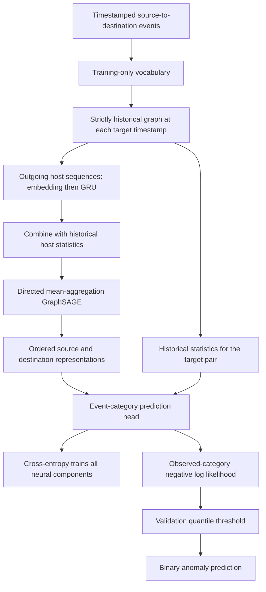

# DeepCASE-GNN: code, mathematics, and learning concepts

This guide explains the `deepcase_gnn` implementation in this checkout, reviewed
2026-10-10. It is a companion to the [DeepCASE guide](deepcase-code-math-guide.md),
with the same emphasis on executable code, tensor contracts, mathematics, and
learning concepts. It describes the current pilot implementation, not a claim
about detection performance or a completed thesis evaluation.

## 1. What is learned, and where?

DeepCASE-GNN learns the probability of an authentication event category given
strictly earlier activity and the observed source/destination hosts. It scores
an observed event by how surprising its category is under that distribution.

| Component | Input | Output | Learning role |
| --- | --- | --- | --- |
| [LANL adapter](../deepcase_gnn/preprocessing/lanl.py) | Authentication rows and optional red-team file | Event signatures, endpoints, stable row IDs, optional labels | Deterministic preparation |
| [Preprocessor](../deepcase_gnn/preprocessing/preprocessor.py) | Training vocabulary and timestamped host interactions | Historical graph snapshots and event targets | Vocabulary fitting and deterministic features |
| [ContextBuilder](../deepcase_gnn/context_builder/context_builder.py) | Host sequences, node statistics, directed graph, target endpoints | Event-category logits | Jointly trained embedding, GRU, GraphSAGE, and event head |
| [Interpreter](../deepcase_gnn/interpreter/interpreter.py) | Validation surprise scores | Quantile threshold and binary predictions | Label-free calibration |
| [DeepCASEGNN](../deepcase_gnn/module.py) | Chronological data partitions | Training, scoring, calibration, persistence | Orchestration |



The prediction target is an **event category**, not a security label. Labels are
retained for evaluation but do not enter neural training, historical features,
or threshold calibration. High surprise is not a calibrated attack probability.
There is no attention query, DBSCAN clustering, or analyst-score transfer in this
package's Interpreter.

## 2. Notation and tensor contract

Use `V` for the input vocabulary size including reserved tokens, `L` for sequence
length, `D` for embedding width, `H` for hidden width, and `K` for GNN layer count.
For one snapshot, let `n` be its host count, `m` its historical directed-pair count,
and `q` its number of events being scored at the current timestamp.

| Field or intermediate | Shape | Meaning |
| --- | --- | --- |
| `graph.sequence` | `(n, L)` | Integer outgoing-event tokens, right-padded with 0 |
| `graph.lengths` | `(n,)` | Valid token count per host |
| `graph.x` | `(n, 4)` | Historical outgoing-host statistics |
| `graph.edge_index` | `(2, m)` | Historical source and destination node indices |
| `graph.edge_attr` | `(m, 4)` | Historical pair statistics; not passed to GraphSAGE |
| `graph.edge_weight` | `(m,)` | Pair interaction counts; not passed to GraphSAGE |
| `graph.target_index` | `(2, q)` | Ordered endpoints of events being scored |
| `graph.target_attr` | `(q, 4)` | Historical statistics for each target pair |
| `graph.y` | `(q,)` | Observed event tokens, always at least 1 |
| `graph.row_position` | `(q,)` | Positions in the chronologically sorted scored frame |
| Embedded sequences | `(n, L, D)` | Trainable event embeddings |
| Encoded nodes | `(n, H)` | Host representations after projection and GNN |
| Output logits | `(q, V-1)` | One row per observed event; padding excluded |

PyG batches snapshots as a disjoint union: node, edge, and target counts add
across snapshots. It offsets `edge_index` and `target_index` by cumulative node
counts, so endpoint selection stays inside each snapshot. `row_position` retains
its dataset row positions for assembling the score table.

`batch_size=8` therefore means eight **timestamp snapshots**, not eight events
or hosts. A busy timestamp can produce a large batch even with `batch_size=1`.

## 3. Input preparation and vocabulary

### 3.1 Generic event tables

`validate_frame` requires `timestamp`, `event`, `source_computer`, and
`destination_computer`. Timestamps must be finite numeric seconds. Required
fields cannot be null; host IDs cannot be empty or `?`. Event categories and
host IDs are converted to strings. The validator copies the frame, sorts by
timestamp with a stable sort, and resets the index.

Supply unique, non-null `event_id` values before splitting the dataset. If absent,
IDs are derived from the input DataFrame index. Independently resetting each
partition's index can therefore create overlapping IDs. The validator converts
supplied IDs to strings before its null check, so callers should check missing
IDs themselves rather than relying on that check to reject them.

Optional `source_user` and `success` columns enable statistics. Success/failure
comparisons are exactly `Success` and `Fail`. Optional `label` values must be
binary 0/1 and remain evaluation metadata.

### 3.2 Training-only category mapping

`Preprocessor.fit(train)` assigns sorted unique training event strings tokens
`2, ..., V-1`, reserving:

| Token | Meaning | Output class |
| --- | --- | --- |
| `0` | PAD | No output class |
| `1` | UNK: category unseen during fitting | `0` |
| `2, ..., V-1` | Known training categories | `1, ..., V-2` |

The model outputs `V-1` classes and trains against `graph.y - 1`. For training
categories `Fail` and `Success`, their tokens are 2 and 3, respectively, while
output classes are `[UNK, Fail, Success]`.

`transform` reuses the fitted mapping. This prevents validation/test categories
from expanding the learned vocabulary. Unknown historical categories receive
token 1, and unknown targets are scored against output class 0. Training normally
contains no UNK targets or UNK history, so neither that output category nor its
input embedding is trained from positive unknown examples. UNK scores should
not be interpreted as a separately calibrated novelty detector.

### 3.3 LANL event signatures and labels

`read_lanl` reads the nine authentication columns and builds the event string
from a compact JSON array containing:

1. Authentication type.
2. Logon type.
3. Authentication orientation.
4. Success/failure value.
5. Whether source and destination users differ, represented as a string.

Host names and raw user identities are not event vocabulary entries. Hosts define
the graph; source users contribute distinct-user counts. User mismatch is part
of the category being predicted. There are no trainable host or user ID tables.

The default `remote-logon` scope retains distinct, known source/destination
computers with orientation `LogOn`. `auth_scope="all"` permits local and other
orientations, but still rejects unknown endpoints. Physical row IDs are assigned
before filtering, so duplicate authentication records remain distinct targets.

If a red-team file is supplied, labels use exact membership of
`(timestamp, source_user, source_computer, destination_computer)` in its keys.
Duplicate rows with matching keys are all labeled. Zero means no known match,
not proof of benign activity. `nrows` limits physical input rows before filtering;
it does not guarantee a useful chronological experiment interval.

## 4. Historical graph construction

### 4.1 Time window and simultaneous events

For a target timestamp `t` and window width `W`, history is:

$$
\mathcal H_t = \{e_i : t-W \le t_i < t\}.
$$

The lower bound is inclusive; the current timestamp is excluded. All targets at
`t` share one graph snapshot, so simultaneous events cannot enter one another's
sequences, edges, or statistics. The target endpoints can add isolated nodes to
the graph, but target events do not create historical edges.

For example, with `W=3` and history `A→B@1`, `B→C@2`, `A→B@2`, targets at time 3
see all three earlier rows and two directed pairs. At time 5, only the two rows
at time 2 remain from this history. An event at time 5 is excluded from the time-5
snapshot. Repeated `A→B` rows count separately in statistics but form one edge.

Hosts are the sorted union of historical endpoints and current target endpoints.
Indices are local to each snapshot; they are not learned persistent identities.
Earlier equal-time rows retain input order for sequence truncation. That order
is reproducible but does not establish which simultaneous event happened first.

### 4.2 Host-local outgoing sequences

For each host `v`, select its outgoing events in `H_t`, keep the last `L`, and
place them oldest to newest at the beginning of its sequence. Padding is on the
right: `[A, B, PAD]`, not `[PAD, A, B]`.

A host seen only as a destination has an empty outgoing sequence. The GRU does
not directly encode incoming events; incoming-neighbor information arrives
through the graph. Exact time gaps are not GRU inputs. Time determines window
membership and the pair recency feature.

### 4.3 Host and pair statistics

For host `v`, let `c_v` be its outgoing row count, `u_v` its distinct source-user
count, and `s_v`, `f_v` its success and failure counts. Its node feature is:

$$
x_v = [\log(1+c_v),\log(1+u_v),\log(1+s_v),\log(1+f_v)].
$$

These counts use the **entire window**, even when the sequence is truncated to
`L`. Missing optional user/success columns produce zero corresponding features.
Hosts without outgoing history have a zero feature vector.

For each historical ordered pair `(u,v)`, its four attributes are:

$$
a_{uv} = \left[
\log(1+c_{uv}),\ \log(1+d_{uv}),\ \rho_{uv},\
\frac{t-t^{last}_{uv}}{W}
\right],
$$

where `c` counts rows, `d` counts distinct source users, `rho` is the fraction
whose success field equals `Fail`, and `t_last` is the latest pair timestamp.
The failure fraction divides by all pair rows, including any other success-field
values. Missing optional columns give zero user count or failure fraction.

The graph stores `edge_weight=c_uv` and `edge_attr=a_uv`. A target pair copies
its historical attributes into `target_attr`; an unseen pair gets four zeros.
The same historical pair can supply attributes to multiple target events.

### 4.4 Partition boundaries and sequential scoring

`transform(frame, history=earlier)` requires all explicit history timestamps to
precede the earliest scored timestamp, with disjoint event IDs. Split at timestamp
boundaries rather than dividing simultaneous rows across partitions.

Earlier rows within the scored frame become history for later rows. Thus test
scoring represents sequential observation of the test stream with fixed weights.
Use training history for validation, and training plus validation history for
test. The window still expires old observations. No raw history is retained in
a saved model or automatically carried between separate calls to `score`.

## 5. Context Builder: GRU plus directed GraphSAGE

### 5.1 Trainable embedding and GRU

`nn.Embedding(V,D,padding_idx=0)` learns dense category vectors. Its padding row
starts at zero and is excluded from ordinary embedding-gradient updates.
`pack_padded_sequence` prevents trailing padding from becoming recurrent steps.

For embedded event `e_j` and previous state `h_(j-1)`, the GRU uses reset and
update gates:

$$
\begin{aligned}
r_j &= \sigma(W_{ir}e_j+b_{ir}+W_{hr}h_{j-1}+b_{hr}),\\
z_j &= \sigma(W_{iz}e_j+b_{iz}+W_{hz}h_{j-1}+b_{hz}),\\
\widetilde h_j &= \tanh(W_{in}e_j+b_{in}
 +r_j\odot(W_{hn}h_{j-1}+b_{hn})),\\
h_j &= (1-z_j)\odot\widetilde h_j+z_j\odot h_{j-1}.
\end{aligned}
$$

The final state summarizes each host's outgoing-event order. The reset gate
controls previous-state contribution to the candidate; the update gate mixes
old state and candidate. This is one unidirectional GRU layer, starting from
zero state, without an attention decoder.

Packed sequences require positive lengths. The code temporarily clamps empty
lengths to one, runs the GRU, then multiplies its final state by `length != 0`.
The resulting temporal vector is **exactly zero for an empty history**, even
though GRU biases could otherwise produce a nonzero output on padding.

### 5.2 Initial node representation

The model concatenates temporal state `h_v` with the four host statistics:

$$
z_v^{(0)} = \operatorname{ReLU}(W_p[h_v\Vert x_v]+b_p),
\qquad W_p\in\mathbb R^{H\times(H+4)}.
$$

Here `||` denotes concatenation and `ReLU(a)=max(0,a)`. Empty-history nodes can
have nonzero projected representations because the projection has a learned
bias. A zero temporal vector does not imply a zero final node embedding.

### 5.3 Directed mean-aggregation GraphSAGE

For layer `k`, define incoming neighbors
`N_in(v)={u : historical edge u→v exists}`. The configured `SAGEConv` computes:

$$
\begin{aligned}
m_v^{(k)} &= \operatorname{mean}_{u\in\mathcal N_{in}(v)}z_u^{(k-1)},\\
\widehat z_v^{(k)} &= W_{neighbor}^{(k)}m_v^{(k)}+b^{(k)}
                    +W_{root}^{(k)}z_v^{(k-1)},\\
z_v^{(k)} &= \operatorname{Dropout}(\operatorname{ReLU}(\widehat z_v^{(k)})).
\end{aligned}
$$

An empty neighborhood has zero aggregate. The root transform preserves a route
for a host's own features even when it has no incoming edges. The configured
operator has no pre-aggregation projection or output L2 normalization.

Edges are source → destination; reverse edges are not added. With `A→B→C`, one
layer can move A's representation into B and B's into C; two layers let A
influence C. This is structural propagation within one historical snapshot, not
a guarantee that edges along a path occurred in causal chronological order.
Historical self-edges are possible for generic/all-scope input; the root term is
still present when a node also appears in its own neighbor aggregate.

Each distinct historical source neighbor has equal weight in the mean. Ten
historical interactions from A to B do not create ten messages. The forward
call is `conv(nodes, graph.edge_index)`: **edge attributes and edge weights are
not used by message passing**. Counts can still affect outgoing-host statistics,
sequences, and the target pair's event-head attributes.

Dropout defaults to 0.1 after every GNN layer and in the event head. During
training it randomly zeros coordinates and rescales retained values by `1/0.9`;
it is disabled during scoring. There is no explicit dropout on the embedding,
GRU, or initial projection in this implementation.

### 5.4 Ordered endpoints and event-category logits

For each observed event from source `s` to destination `d`, the head computes:

$$
\begin{aligned}
r_{sd} &= [z_s^{(K)}\Vert z_d^{(K)}\Vert a_{sd}],\\
f_{sd} &= \operatorname{Dropout}(\operatorname{ReLU}(W_1r_{sd}+b_1)),\\
\ell_{sd} &= W_2f_{sd}+b_2,\\
p(c\mid\mathcal H_t,s,d) &= \frac{\exp(\ell_{sd,c})}
                                  {\sum_{j=0}^{V-2}\exp(\ell_{sd,j})}.
\end{aligned}
$$

`W1` maps `2H+4` to `H`, and `W2` maps `H` to `V-1`. Endpoint concatenation is
ordered: reversing source and destination can change the prediction. `forward`
returns raw **logits**, not probabilities or log probabilities. Use
`logits.softmax(-1)` for probabilities and `logits.argmax(-1)+1` for token IDs.

The observed category is absent from head inputs. Endpoints are known when an
event arrives: this models category conditional on history and those endpoints,
not the probability that the host pair itself will communicate. There is no
separate destination-novelty or user-identity score. Targets at the same time with
the same ordered endpoints have identical logits in evaluation mode; their
scores can differ if their observed categories differ.

## 6. Training, loss, and optimization

### 6.1 Categorical cross-entropy

For a batch containing `Q` target events with tokens `y_i`, training minimizes:

$$
\mathcal L_{batch} = -\frac{1}{Q}\sum_{i=1}^{Q}
\log p(y_i-1\mid\mathcal H_{t_i},s_i,d_i).
$$

`F.cross_entropy(logits, graph.y-1)` combines a numerically stable log-softmax
with negative log likelihood. There is no label smoothing, security-label
supervision, class weighting, negative-edge sampling, or attention loss.
Every physical target row contributes, including duplicate records.

Within a batch, the mean weights events equally, so busy snapshots contribute
more terms. Each batch then receives one optimizer step, even if event counts
vary across batches. Consequently the update sequence is not equivalent to a
single globally event-averaged gradient. Reported epoch loss *is* an event-weighted
mean: `sum(batch_mean_loss * batch_event_count) / total_events`.

### 6.2 Joint backpropagation and Adam

`DeepCASEGNN.fit` fits a fresh vocabulary, initializes a new model, resets the
Interpreter and loss history, and creates Adam with `learning_rate=0.001`.
Repeated `fit` calls restart training; they do not continue a checkpoint.

For each shuffled batch of snapshots, the loop clears gradients, computes loss,
checks that it is finite, backpropagates, clips the global parameter-gradient
norm to at most 5, then takes an Adam step. Gradients pass through the event head,
GNN, projection, GRU, and embeddings. Graph construction and categorical IDs
are deterministic inputs, not differentiable learned parameters.

For gradient `g_t` after clipping, Adam maintains moving averages:

$$
\begin{aligned}
m_t&=\beta_1m_{t-1}+(1-\beta_1)g_t,\\
v_t&=\beta_2v_{t-1}+(1-\beta_2)g_t^2,\\
\theta_{t+1}&=\theta_t-\eta\frac{\widehat m_t}{\sqrt{\widehat v_t}+\epsilon}.
\end{aligned}
$$

The hats denote bias correction. The wrapper exposes the learning rate but no
optimizer factory. There is no scheduler, early stopping, or built-in validation
loss loop. Seeds initialize Python, NumPy, PyTorch, and the shuffled loader;
they do not by themselves guarantee identical results on every hardware backend.

## 7. Surprise scores and the Interpreter

### 7.1 Event negative log likelihood

`score` switches to evaluation mode and disables gradient computation. Its
per-event score is:

$$
S_i=-\log p(y_i-1\mid\mathcal H_{t_i},s_i,d_i).
$$

Natural logarithms give scores in nats: probabilities 0.8, 0.1, and 0.01 yield
approximately 0.223, 2.303, and 4.605. Larger values mean greater surprise under
the learned category distribution. This does not establish maliciousness.

The returned DataFrame contains `event_id`, `timestamp`, optional `label`, and
`score`, in chronological order. Join on event IDs to recover another ordering.
Scoring updates neither weights nor vocabulary.

### 7.2 Validation quantile and strict comparison

`calibrate(validation, history=train, quantile=0.99)` computes validation scores
and stores `np.quantile(scores, quantile, method="higher")` as threshold `tau`.
For sorted scores `s_(0),...,s_(n-1)`, this selects:

$$
\tau=s_{(\lceil(n-1)q\rceil)},\qquad
\widehat a_i=\mathbf 1[S_i>\tau].
$$

The comparison is strictly greater: a score equal to the threshold is not an
alert. For `[0.1,0.2,0.4,1.0]` and `q=0.75`, the selected threshold is 1.0, so
none of those validation scores exceeds it. Ties and small validation sets can
make the exceedance fraction smaller than `1-q`.

The quantile controls a validation surprise cutoff, not a guaranteed test false
positive rate. Calibration does not inspect labels or filter known attacks.
`predict` requires prior calibration; `score` does not. Unlike original DeepCASE,
there are no negative fallback codes: prediction is binary 0/1.

### 7.3 Evaluation metrics

`detection_metrics` requires aligned, finite scores and binary labels/predictions.
It reports event count, positive count, precision, recall, trapezoidal area under
the precision-recall curve (`auc_pr`), average precision, and false positive rate.
Average precision and trapezoidal PR area are distinct summaries.

Without positives, recall and both PR metrics are `None`; without negatives,
false positive rate is `None`. Precision uses zero when its denominator is zero.
Evaluate on a held-out chronological test partition after freezing the threshold.
A synthetic demo or training-set score is not evidence of detection quality.

## 8. Wrapper, options, and persistence

| Option | Default | Meaning |
| --- | --- | --- |
| `max_length` | 10 | Last outgoing events encoded per host |
| `window_seconds` | 300 | Historical eligibility for sequences, statistics, and edges |
| `hidden_size` | 64 | GRU, projection, GNN, and event-head hidden width |
| `embedding_size` | 32 | Trainable event-vector width |
| `gnn_layers` | 2 | Number of directed message-passing layers |
| `dropout` | 0.1 | Drop probability in GNN layers and event head |
| `seed` | 0 | Initialization and loader random seed |
| `device` | `cpu` | Neural computation device |
| `epochs` | 10 in `fit` | Passes over training snapshots; CLI defaults to 5 |
| `batch_size` | 8 | Timestamp snapshots per batch |
| `learning_rate` | 0.001 | Adam step-size setting |
| `quantile` | 0.99 | Validation surprise cutoff selection |

`gnn_layers=0` skips message passing but retains embeddings, GRU, host statistics,
projection, ordered endpoints, and pair attributes. It is a matched no-message-
passing ablation, not the original DeepCASE model. Keep data splits and training
settings matched when comparing it to the graph model.

`save` stores format version 1, configuration, vocabulary, neural state,
Interpreter threshold, and loss history. `load(path, device="cpu")` reconstructs
the architecture, restores these values, and enters evaluation mode. A model
saved before calibration still requires calibration before binary predictions.

Raw history, data split boundaries, optimizer state, and experiment provenance
are not in that checkpoint. Supply history again at inference and retain the
experiment report separately. The CLI writes `model.pt`, `predictions.csv`, and
`report.json`, including split boundaries, settings, versions, and optional metrics.

## 9. Differences from original DeepCASE

| Topic | Original `deepcase` | Current `deepcase_gnn` |
| --- | --- | --- |
| Context | Previous events on one machine | Outgoing host sequences plus historical host graph |
| Vocabulary | Rebuilt by each preprocessing call; padding entry | Fitted on training; separate PAD and UNK |
| Encoder input | One-hot context | Trainable event embeddings |
| Neural path | GRU, attention decoder, weighted event totals | GRU, host projection, GraphSAGE, endpoint head |
| Neural output | Log probabilities | Raw logits |
| Training objective | Summed smoothed-target KL | Mean categorical cross-entropy per batch |
| Default training optimizer | SGD | Adam with gradient clipping |
| Query optimization | Optimizes attention for the observed event | Absent |
| Interpreter | Per-event clustering and analyst-score lookup | Validation surprise quantile |
| Security supervision | Analyst scores transferred through clusters | Labels used only for evaluation |
| Checkpoint vocabulary | External preparation responsibility | Stored in wrapper checkpoint |

This package reimplements a temporal encoder. It does not load pretrained
DeepCASE weights or attach a GNN to the original attention fingerprints.

## 10. Runnable miniature example

Run from the repository with the GNN dependencies installed in `.venv`. This
example uses the package's synthetic fixture and exercises interfaces, shapes,
chronological history, and checkpoint persistence. Its artificial event stream
does not measure real attack detection.

```python
import tempfile
from pathlib import Path

import numpy as np
import pandas as pd
import torch

from deepcase_gnn import DeepCASEGNN
from deepcase_gnn.__main__ import demo_frame

# Avoid excessive CPU thread overhead for this tiny example.
torch.set_num_threads(1)
frame = demo_frame()
train = frame.loc[frame.timestamp < 50]
validation = frame.loc[(frame.timestamp >= 50) & (frame.timestamp < 70)]
test = frame.loc[frame.timestamp >= 70]

model = DeepCASEGNN(
    max_length=3, window_seconds=20, hidden_size=8,
    embedding_size=4, gnn_layers=2, dropout=0.0, seed=7,
)
model.fit(train, epochs=2, batch_size=8)
threshold = model.calibrate(validation, history=train, quantile=0.9)
history = pd.concat([train, validation], ignore_index=True)
result = model.predict(test, history=history)
assert len(result) == len(test)
assert np.isfinite(result.score).all()
assert result.prediction.isin([0, 1]).all()

dataset = model.preprocessor.transform(test, history=history)
graph = dataset[0].to(model.device)
with torch.no_grad():
    logits = model.context_builder(graph)
    probabilities = logits.softmax(-1)
assert logits.shape == (graph.y.numel(), model.preprocessor.features - 1)
assert torch.allclose(probabilities.sum(-1), torch.ones(graph.y.numel()))
assert torch.allclose(
    -probabilities[torch.arange(graph.y.numel()), graph.y - 1].log(),
    torch.tensor(result.score.iloc[:graph.y.numel()].to_numpy(), dtype=logits.dtype),
)

with tempfile.TemporaryDirectory() as directory:
    checkpoint = Path(directory) / "model.pt"
    model.save(checkpoint)
    restored = DeepCASEGNN.load(checkpoint)
    pd.testing.assert_frame_equal(result, restored.predict(test, history=history))

print("Vocabulary:", model.preprocessor.vocabulary)
print("Epoch NLL:", model.loss_history)
print("Threshold:", threshold)
print(result.head())
```

The command-line equivalent for a full synthetic workflow is:

```bash
OMP_NUM_THREADS=1 .venv/bin/python -m deepcase_gnn \
  --demo --epochs 2 --output /tmp/deepcase-gnn-demo
```

## 11. Limits and interpretation

The current dataset holds the event table in memory and lazily rebuilds each
snapshot, including overlapping history windows. Message passing uses complete
neighborhoods, with no neighbor sampling. Large windows, many distinct timestamps,
and many simultaneous targets can therefore be expensive. Moving the model to a
GPU does not remove the pandas preprocessing and snapshot-construction work.

The architecture shares parameters across host identities, allowing unseen hosts
to be represented from their available features and neighbors. However, hosts
with no outgoing history and the same graph role can be indistinguishable. Pair
attributes provide some interaction-specific information, but the model does
not learn a probability distribution over candidate destinations.

The training partition is assumed to represent background behavior and is not
filtered using red-team labels. Attacks in training may become less surprising.
Unknown categories, incomplete labels, changing traffic distributions, and the
chosen authentication scope all affect interpretation of evaluation results.
Neither this implementation nor its unit tests establish an improvement over
original DeepCASE; that requires matched held-out experiments.

## 12. Verification and suggested reading order

This guide was checked against the local source and installed PyG `SAGEConv`
implementation. Verification used PyTorch `2.11.0+cu128` and PyG `2.8.0.post1` on
CPU. The miniature example above and all eight tests in
[test_deepcase_gnn.py](../tests/test_deepcase_gnn.py) passed. Those tests cover
historical boundaries, simultaneous events, vocabulary handling, endpoint batch
offsets, batching equivalence, gradients, topology sensitivity, label-independent
training, calibration, checkpoint restoration, ablation, and metric edge cases.
These are implementation checks, not accuracy estimates.

Read `read_lanl`, then `Preprocessor.fit`, `transform`, and
`HostGraphDataset.__getitem__`. Follow `ContextBuilder.encode` and `forward`,
then the wrapper's `fit`, `score`, and `calibrate`. Finally read
`Interpreter.calibrate`, `predict`, and `detection_metrics`.

For usage and input-design context, see the
[package README](../deepcase_gnn/README.md) and [GNN input data](gnn-input-data.md).
For the baseline's different learning and interpretation pipeline, return to the
[original DeepCASE guide](deepcase-code-math-guide.md).
